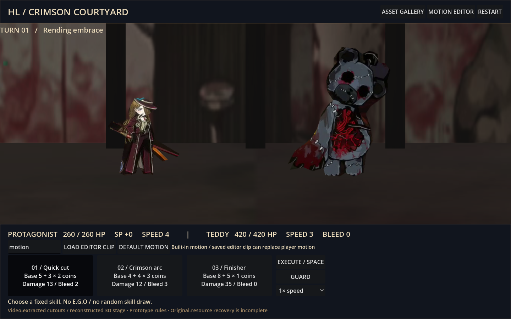

# project-HL · Godot 전투 게임 / 모션 워크숍

사용자가 제공한 두 전투 영상에서 화면에 보이는 캐릭터·효과를 추출해 적용한 **플레이 가능한 1대1 전투 프로토타입**입니다.
원본 게임 자산 전체를 복원한 결과나 원작 전투 규칙의 완전한 재현은 아닙니다.



[실제 조작 녹화](docs/playtest.mp4) · [녹화 프레임 모음](docs/playtest-sheet.jpg) · [자산 갤러리](docs/asset-gallery.png)

## PC에서 실행

1. GitHub의 **Code → Download ZIP**으로 내려받아 압축을 풉니다.
2. Godot **4.6 일반 버전**에서 **가져오기(Import)**를 선택합니다. .NET 버전은 필요 없습니다.
3. `godot/project.godot`을 열고 **F5**를 누릅니다. 첫 실행 때 이미지 임포트를 기다립니다.

추가 패키지, Node, DB, API 키 없이 실행합니다. Windows 실행은 아직 직접 검증하지 않았습니다.
리눅스 터미널에서는 `./scripts/godot.sh`로 실행합니다.

## 전투 조작

| 기능 | 조작 |
| --- | --- |
| 고정 스킬 선택 | 하단 카드 또는 숫자 1 / 2 / 3 |
| 턴 실행 | EXECUTE 또는 Space |
| 방어 | GUARD |
| 재시작 | RESTART 또는 R |
| 느린 재생 | 우측 배속 선택 |
| 추출물·출처 확인 | ASSET GALLERY |
| 모션 제작 | MOTION EDITOR |

전투는 스킬 선택 → 합에서 코인 파괴 → 남은 코인으로 연속 공격 → 피격·출혈·흐트러짐 → 다음 턴으로 진행합니다.
적은 턴에 따라 정해진 스킬을 사용합니다. 코인 판정에는 난수가 사용되며 스킬 목록은 무작위로 배정되지 않습니다.
E.G.O는 없습니다. 피해·정신력·상태 효과 수치는 이 프로젝트의 임시 규칙입니다.

## 애니메이팅

모션 편집기 하단에서 키 선택 → 시간·위치·회전·크기·줌·포즈·보간 수정 → **APPLY KEY**.
키를 추가·삭제하고 타임라인을 움직이거나 배속으로 재생합니다. 포즈 개수는 고정하지 않습니다.
`idle / windup / strike / guard / hurt`는 추출된 포즈에 연결됩니다.
추가 이미지는 `res://assets/파일명.png` 경로로 지정할 수 있습니다.

이벤트 목록에서 다중 타격 시간·피해·히트스톱·VFX 색·각도·크기·지속시간을 편집합니다.
클립 이름을 입력하고 **SAVE JSON**으로 저장한 뒤 **BACK TO BATTLE**로 돌아갑니다.
전투 하단에 같은 이름을 입력해 **LOAD EDITOR CLIP**을 누르면 주인공 위치·포즈·회전·크기·카메라 모션에 적용됩니다.
현재 사용자 모션은 코인별 공격마다 0.65초로 압축 재생됩니다. 전투 피해·VFX 시점은 전투 판정이 관리하며
편집기의 타격 이벤트를 전투 판정에 직접 연결하지는 않습니다.

파일은 Godot의 `user://<클립 이름>.json`에 저장됩니다. 편집기 화면에 실제 위치가 표시됩니다.
명령줄 스크립트로 실행하면 사용자 데이터와 캐시는 무시되는 `.local/`에 저장합니다.

## 추출 자산

`godot/assets/extracted/manifest.json`에 **52개 항목**의 영상 번호·시각·크롭/마스크 방식을 기록했습니다.
주인공 3포즈, 적 2포즈, 두 효과 시퀀스 각 20샘플, 벽·바닥 패치, 테두리 2개, 배경 보정 실험 1개, 영상 인덱스 2개입니다.
미리보기·보정 마스크 파일은 별도 보조 자료입니다. 60Hz로 샘플한 30fps 영상이므로 효과에는 중복 프레임이 있습니다.
저해상도·잘린 부분·구워진 조명·일부 UI 흔적이 남습니다. 원본 레이어·가려진 포즈·3D 맵·개별 음원은 복원하지 못했습니다.
배경 보정 실험은 품질이 낮아 게임에서 사용하지 않으며, 가려지지 않은 패치를 3D 지형에 입혔습니다.

다시 추출하려면 Python 가상환경에 `tools/requirements.txt`를 설치한 뒤 실행합니다.

```bash
python tools/extract_reference.py video1.mp4 video2.mp4
```

## 검증

리눅스에서는 `./scripts/check.sh`로 임포트와 아래 세 검사를 한 번에 실행할 수 있습니다.
스크립트는 Godot 종료 코드와 오류 출력, 통과 메시지를 함께 확인합니다.

```bash
./scripts/godot.sh --headless --editor --import --quit
./scripts/godot.sh --headless --script res://tests/combat_test.gd
./scripts/godot.sh --headless -- --game-smoke
./scripts/godot.sh --headless res://main.tscn -- --smoke
```

Godot 4.6.3 임포트, 128개 시드의 전투 판정/종료, 전투 장면/클립 로딩, 기존 편집기 저장·재생 검사 통과.
Xorg dummy + Mesa llvmpipe에서 실제 창 렌더링, 갤러리 열기, 전투 실행 버튼과 턴 진행을 점검했습니다.
하드웨어 GPU·오디오·Windows는 미검증입니다.

[추출 품질과 다음 작업](docs/DEVELOPMENT_KO.md)
